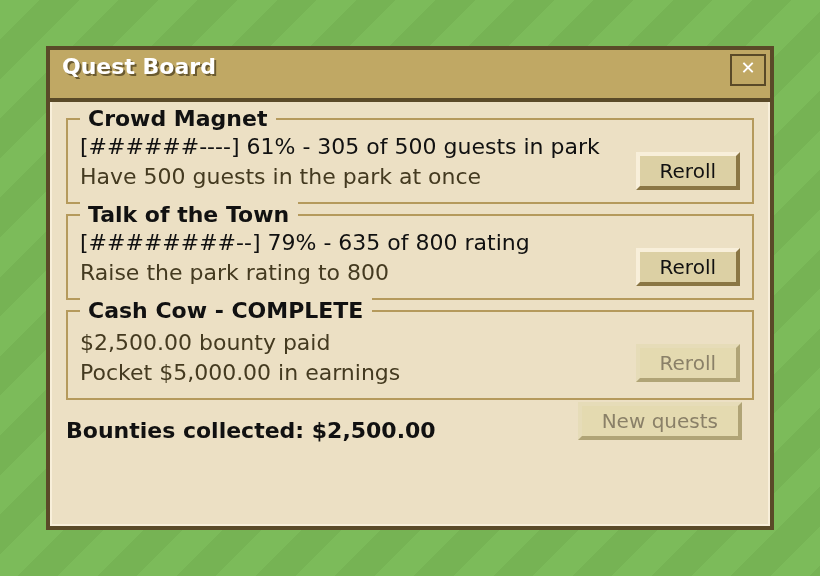
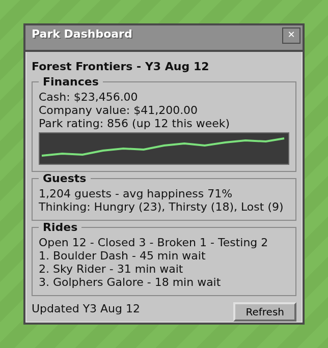
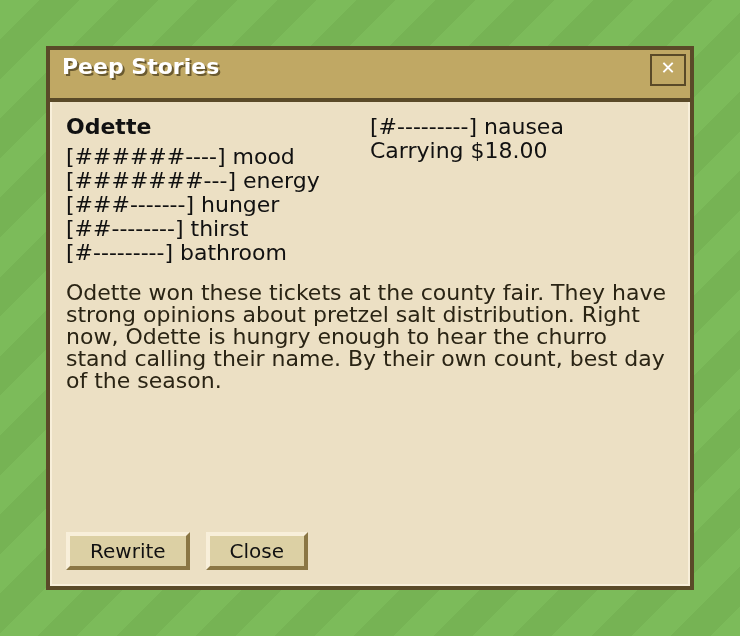

# OpenRCT2 Plugins

Three plugins for OpenRCT2, written in TypeScript against the official
[scripting API](https://github.com/OpenRCT2/OpenRCT2/blob/develop/distribution/scripting/scripting.md).
Ready-to-use `.js` bundles are included — copy them in and play, no build step
required.

| Plugin | Menu entry | What it does |
|---|---|---|
| [Quest Board](quest-board/) | Map menu → Quest Board | Procedural park quests with cash bounties |
| [Park Dashboard](park-dashboard/) | Map menu → Park Dashboard | Finances, guests and rides in one dense panel |
| [Peep Stories](peep-stories/) | Map menu → Peep Stories | Click any guest, read a story grounded in their actual state |

## Quest Board

Rolls three quests when a park starts — guest count, park rating, cash earned,
ride count, ride excitement or park value — and tracks progress every in-game
day. Finishing a quest pays the bounty and posts it to the park's news feed.
Each quest can be rerolled; a fresh set appears once all three are done.
Quest state lives in the park file, so every park gets its own board.



## Park Dashboard

One at-a-glance window instead of window sprawl: cash, company value and park
rating with a weekly trend, a 30-day cash sparkline, guest count with average
happiness and the most common guest thoughts, ride status counts and the three
longest queue waits. Updates every in-game day or on demand.



## Peep Stories

Activate the tool from the map menu, then click a guest. You get their vitals
(mood, energy, hunger, thirst, bathroom) and a short story generated from what
is actually happening to them — hungry guests are hunting churros, lost guests
are walking past the same kettle corn stand for the third time. The story is
generated once per guest and saved in the park, so they stay the same person
when you come back. Rewrite regenerates.



## Install

Copy a plugin's `dist/<name>.js` into OpenRCT2's plugin folder and restart the
game:

- Linux: `~/.config/OpenRCT2/plugin`
- Windows: `%USERPROFILE%\Documents\OpenRCT2\plugin`
- macOS: `~/Library/Application Support/OpenRCT2/plugin`

## Building from source

Requires Node.js 18+. The API typings are not vendored; fetch them first:

```sh
curl -fsSL -o openrct2.d.ts \
  https://raw.githubusercontent.com/OpenRCT2/OpenRCT2/develop/distribution/scripting/openrct2.d.ts
npm install
npm run build      # bundles all three plugins into dist/
npm run typecheck  # strict typecheck against openrct2.d.ts
```

## Notes

- The screenshots above are faithful mockups of the window layouts rendered
  from the widget code, not in-game captures.
- Tested against the OpenRCT2 `develop` API and verified by typecheck and
  bundling. Field reports on odd layouts or behavior are very welcome.
- These are fan-made plugins for OpenRCT2 and are not affiliated with or
  endorsed by the OpenRCT2 project.

## License

[MIT](LICENSE)
